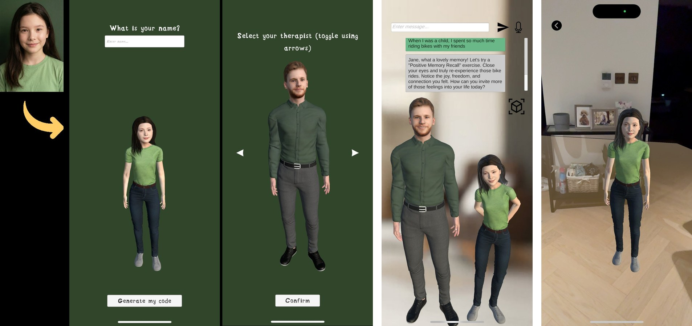
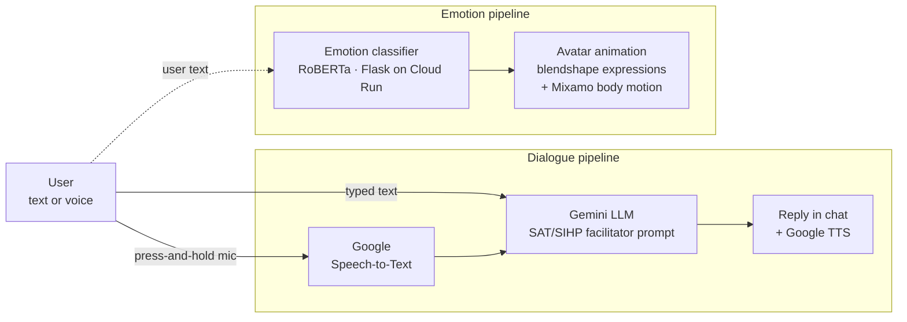
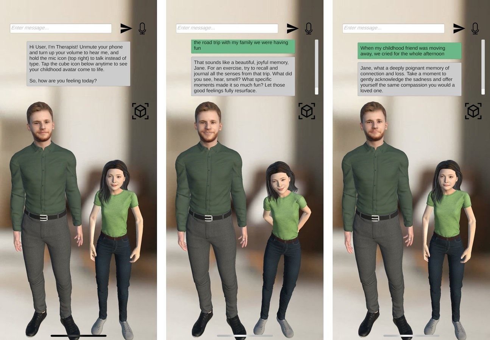

<h1 align="center">Embodied Empathy</h1>

<p align="center">
  <b>A Multimodal AR and LLM-Powered System for Self-Attachment Psychotherapy with Self-Initiated Humour</b>
</p>

<p align="center">
  Xinyan Ye · Gwyneth Phang · Anandha Gopalan · Abbas Edalat<br>
  Imperial College London
</p>

<p align="center">
  <i>ICMI Companion '26 · Napoli, Italy</i>
</p>

<p align="center">
  <a href="https://doi.org/10.1145/3776591.3838179"></a>
  <a href="https://arxiv.org/abs/2608.02283"></a>
  
  
  <a href="LICENSE"></a>
</p>

<p align="center">
  
</p>

<p align="center"><sub>Child avatar from a photo and therapist choice · Virtual therapy room · AR mode</sub></p>

---

## Overview

**Embodied Empathy** is an iOS app that delivers the two-stage **Self-Attachment Technique (SAT)** and **Self-Initiated Humour Protocol (SIHP)** in a single, embodied experience. Earlier SAT/SIHP pilots split the experience across a Google Cardboard VR avatar and a separate rule-based web chatbot. This system brings everything into one app:

- 🧒 **Personalised childhood-self avatar.** Users upload a childhood photo, and [MetaPerson](https://metaperson.avatarsdk.com/) turns it into a customisable 3D child avatar. Avatars are stored as GLB and can be reloaded with an 8-digit share code.
- 🧑‍⚕️ **Choice of therapist avatar.** Users pick a virtual therapist from a diverse gallery.
- 🤖 **LLM-driven therapist.** Google **Gemini** is prompted to act as a supportive SAT/SIHP facilitator. It validates, reiterates and labels the user's feelings (mirroring and containment) and recommends exercises.
- 🎭 **Automated emotion mirroring.** A fine-tuned **RoBERTa** classifier reads each user message. The child avatar mirrors the detected emotion through FACS-style blendshapes and Mixamo body animations, and the therapist shows a calm, regulated empathic response.
- 🗣️ **Voice in and out.** Users can press and hold the mic to speak (Google Speech-to-Text). Every therapist reply is read aloud (Google Text-to-Speech) in a voice matched to the therapist's persona.
- 📱 **On-demand AR.** Using AR Foundation and ARKit, users can place their childhood self in their own room.

## System architecture

Every user message runs through two pipelines in parallel:



<p align="center">
  
  <br><sub>Emotion mirroring: session greeting · positive message · negative message</sub>
</p>

## Repository structure

```
embodied-empathy/
├── ar-app/                  # Unity 2022.3 LTS project (iOS, AR Foundation + ARKit)
│   ├── Assets/
│   │   ├── AvatarSelector/  # child-avatar generation (MetaPerson), therapist selection, share codes
│   │   ├── ChatbotInteract/ # Gemini chat, STT/TTS, emotion requests, expression + animation control
│   │   ├── EmotionDisplay/  # facial-expression presets and animator controllers
│   │   ├── ARDisplay/       # AR placement of the child avatar
│   │   └── EnvLoader.cs     # loads API keys from Assets/Resources/env.txt at startup
│   ├── env.example.txt      # template for Assets/Resources/env.txt
│   └── README.md
├── emotion_classifier/      # Flask server for the RoBERTa emotion model (Docker, Cloud Run)
│   ├── app.py
│   ├── Dockerfile
│   ├── tokenizer/
│   └── README.md
└── docs/
    ├── THIRD_PARTY.md       # third-party assets you need to download yourself
    └── figures/
```

## Getting started

### Prerequisites

- **Unity 2022.3 LTS** (developed on 2022.3.62f2) with the iOS Build Support module
- **Xcode** and an ARKit-capable iPhone
- A **Google Cloud** project with these APIs enabled: Generative Language (Gemini), Cloud Speech-to-Text and Cloud Text-to-Speech
- A **MetaPerson / AvatarSDK** developer account (client ID and secret)
- **Python 3.10+** for the emotion classifier

### 1. Start the emotion classifier

```bash
cd emotion_classifier
pip install -r requirements.txt
# Download RoBERTa_12_emotions.pt (see emotion_classifier/README.md) into this folder
python app.py          # serves POST /evaluate on http://0.0.0.0:5001
```

Quick test:

```bash
curl -X POST -H "Content-Type: application/json" -d '{"text": "im happy"}' http://localhost:5001/evaluate
```

To deploy it on Google Cloud Run, see [`emotion_classifier/README.md`](emotion_classifier/README.md).

### 2. Configure and build the Unity app

1. Download the third-party assets listed in [`docs/THIRD_PARTY.md`](docs/THIRD_PARTY.md) and place them at the paths given there.
2. Copy `ar-app/env.example.txt` to `ar-app/Assets/Resources/env.txt` and fill in your keys. This file is git-ignored.
3. Open `ar-app/` in Unity Hub.
4. In `ChatbotInteract/ChatbotScene.unity`, select the object with the `EmotionClassifier` component and set **Emotion Classifier Url** to your classifier endpoint (`http(s)://<host>/evaluate`). A phone cannot reach `localhost` on your computer, so use your machine's LAN IP or the Cloud Run URL.
5. Go to **File → Build Settings → iOS → Build**, then open the generated Xcode project, set up signing and run it on your device.

See [`ar-app/README.md`](ar-app/README.md) for more details.

## User study

We ran an eight-day remote study with **16 non-clinical adults** who used their own iPhones for 20–45 minutes a day. Days 1–2 focused on self-attachment with the child avatar. Days 3–8 were SIHP exercises with the LLM therapist, in the virtual room or in AR.

| Finding | Evidence (mean score, 0–100) |
|---|---|
| Personalised avatars anchor the bond, but realism lags behind | Therapist display 67.2 · Child avatar satisfaction 64.1 · Child avatar realism 48.4 |
| Emotion mirroring engages users when it is accurate, but misfires hurt | Emotion clarity 57.8 · Perceived empathy 59.4 |
| Voice output helps, and voice input divides users | TTS usefulness 64.1 (SD 27.3) · Voice input usefulness 54.7 (SD 37.9) |
| Users want a proactive facilitator, not a reactive responder | 87.5% endorsed the app for emotional self-regulation · Exercise engagement 68.8 · Error recovery 50.0 |

**Design implications:** (1) personalise the avatar first, and use AR in short, guided episodes; (2) moderate the intensity of mirroring and let users correct a wrong emotion; (3) prioritise the therapist's voice, while keeping typing as a first-class input; (4) make the therapist proactive and recover gracefully from errors.

> ⚠️ **Disclaimer.** This is a research prototype. It is not a medical device and is not a substitute for professional mental-health care. The general-purpose LLM it uses has not been clinically validated.

## Citation

If you find this work useful, please cite:

```bibtex
@inproceedings{ye2026embodied,
  title     = {Embodied Empathy: A Multimodal AR and LLM-Powered System for Self-Attachment Psychotherapy with Self-Initiated Humour},
  author    = {Ye, Xinyan and Phang, Gwyneth and Gopalan, Anandha and Edalat, Abbas},
  booktitle = {Companion Proceedings of the International Conference on Multimodal Interaction (ICMI Companion '26)},
  year      = {2026},
  address   = {Napoli, Italy},
  publisher = {Association for Computing Machinery},
  doi       = {10.1145/3776591.3838179}
}
```

arXiv version:

```bibtex
@misc{ye2026embodiedarxiv,
  title         = {Embodied Empathy: A Multimodal AR and LLM-Powered System for Self-Attachment Psychotherapy with Self-Initiated Humour},
  author        = {Ye, Xinyan and Phang, Gwyneth and Gopalan, Anandha and Edalat, Abbas},
  year          = {2026},
  eprint        = {2608.02283},
  archivePrefix = {arXiv},
  primaryClass  = {cs.HC}
}
```

## Acknowledgements

The app was originally implemented by Gwyneth Phang in [gphang/ar-psychotherapy](https://github.com/gphang/ar-psychotherapy). This repository is the companion code release for the paper.

We thank [AvatarSDK](https://avatarsdk.com/) for MetaPerson, the Empowered Human Foundation, and all study participants. The work was carried out with the Algorithmic Human Development Group at Imperial College London.

## License

The code in this repository is released under the [MIT License](LICENSE). This covers only the code and the files in this repository. Third-party assets and services, such as MetaPerson/AvatarSDK, Mixamo, UniWebView, Google Cloud APIs and the fonts and models listed in [`docs/THIRD_PARTY.md`](docs/THIRD_PARTY.md), are governed by their own licences and terms. The paper is published under CC BY 4.0.

## Contact

Xinyan Ye: xinyan.ye19@imperial.ac.uk
